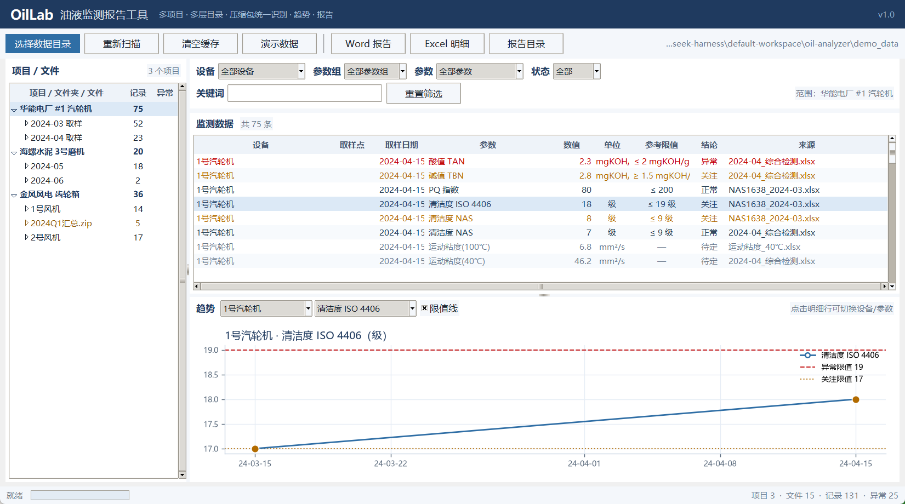
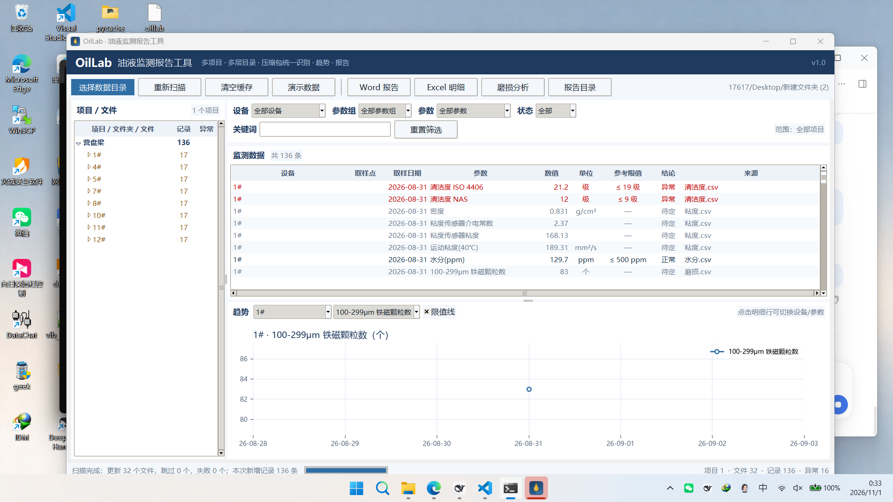
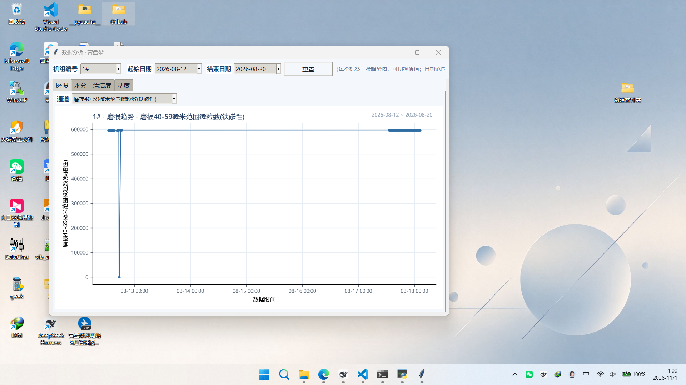
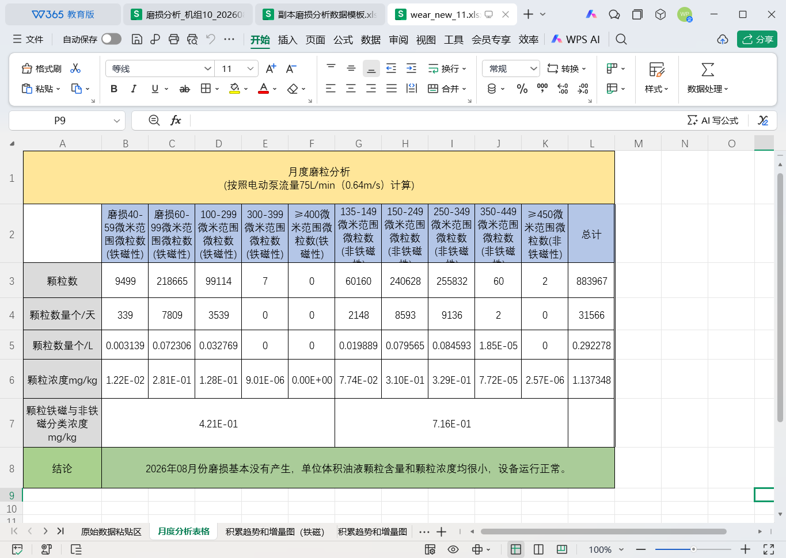
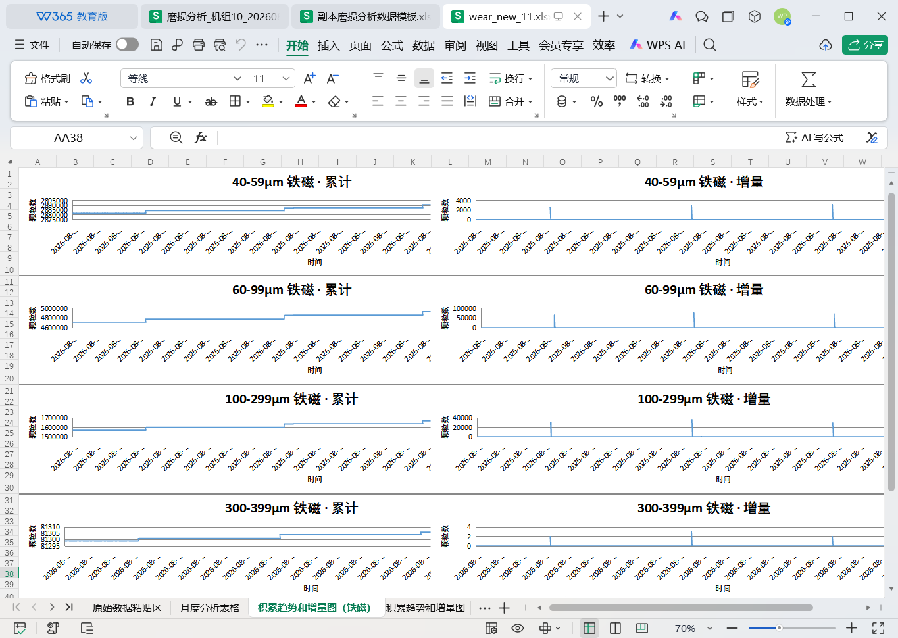
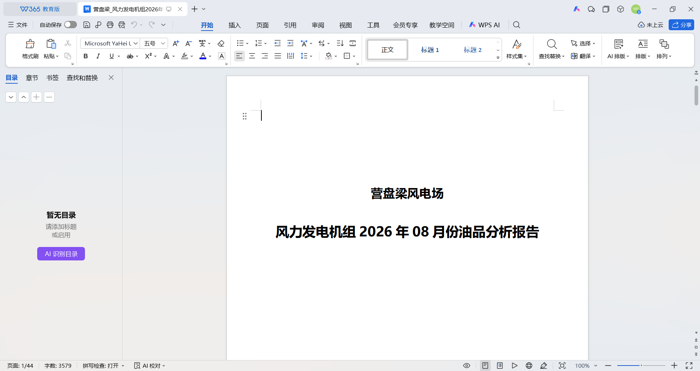
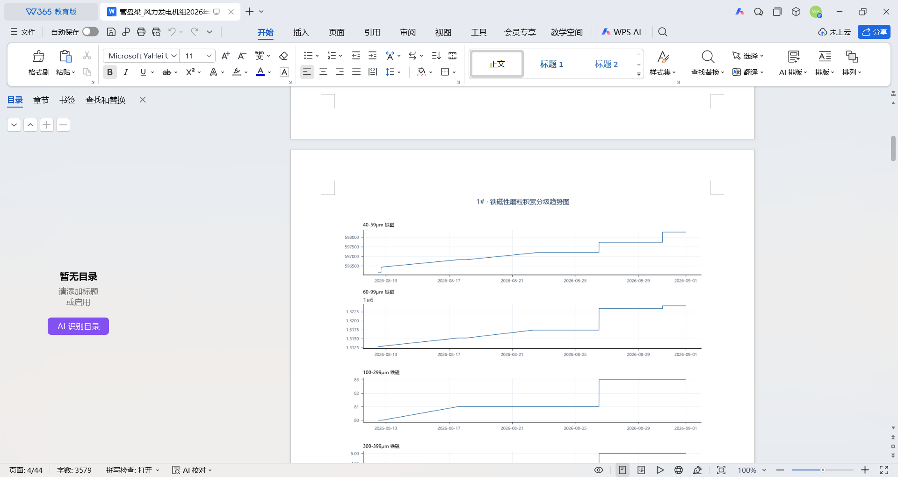

# OilLab · 油液监测报告工具

单文件 Python 桌面程序，代码结构与 **vib_analyzer（风电振动分析工具）** 保持一致：
常量与规则表 → 文件名/表头解析 → SQLite 缓存 → 后台扫描线程 → 主窗口（左侧项目树 + 右侧明细表 + 趋势图）→ 报告导出。



## 与 VIB analyzer 的结构对照

| vib_analyzer | OilLab（本程序） | 说明 |
| --- | --- | --- |
| `APP_DIR` / `STATE_FILE` / `DB_FILE` | 同名常量 | 打包成 exe 后以 exe 所在目录为准 |
| `rule_text → rule_dict`（测点规则表） | `PARAMS`（参数表）+ `META_KEYS`（设备/日期列名） | 参数别名、单位、限值、判定方向 |
| `parse_filename` / `tree_point_order` | `guess_device` / `guess_date` / `parse_workbook` | 从文件名、表头、上层目录推断设备与日期 |
| `vib_cache.db`（趋势缓存） | `oil_cache.db`（files + records） | 按文件 mtime/size 增量，重开秒开 |
| `process_one_csv` + 计算线程 + 队列 | `Scanner.run` + 后台线程 + `queue` 进度 | 扫描时界面不卡，状态栏显示进度 |
| `VibGUI`：工具栏 + 左树 + 右表 + 趋势图 | `OilGUI`：同样的三段式布局 | 左侧项目/文件夹/压缩包树，右侧筛选 + 表格 + 趋势 |
| `SpectrumWindow` 独立谱图窗口 | 趋势图内嵌在主窗口 | 油液监测以趋势为主，不弹独立窗口 |
| `ExportDialog` 导出范围选择 | 无独立导出对话框 | 「报告」按钮先选起止日期，再生成该时段报告 |
| `gui_state.json` 窗口几何与选择记忆 | 同名文件，额外记忆数据目录、筛选、图表选择 | 关掉再开恢复现场 |

单文件约 2800 行，纯 Python 源码，不依赖任何私有包。

## 宾泉项目：模板与历史浓度

- **报告模板**：`templates/宾泉_月度报告模板.docx`。封面、一～六章、报告总览、机组分析（1.1 表、1.2 趋势图、评估结果、诊断结论）都已固定，每月只替换数据。
- **历史浓度**：`templates/宾泉_历史浓度.xlsx`。每台机组一张表，列为「月份 / 铁磁性颗粒 / 非铁磁性颗粒」，范围为 2026.1–2026.9（已删除 2025.12 行与错位重复行，以清洗后版本为准）。
- 宾泉报告的 1.2「月度颗粒浓度趋势图」按「历史表 + 当月实测值」绘制。

## 在 VSCode 里运行

```bash
pip install -r requirements.txt
```

- **图形界面**：双击 `启动.bat` 或 `启动.vbs`（用 pythonw 启动，不会多出黑色控制台窗口，任务栏只有一个程序图标）；也可以在终端 `python oil_monitor_gui.py`，终端里运行时会保留终端窗口，关终端才会退出程序；
- **只跑磨损分析**：打开 `磨损分析.py` 运行，按提示输入数据目录；或在终端：

```bash
python 磨损分析.py "D:\油液数据" "D:\输出目录"
```

两种方式都是源码运行，不需要打包 exe。若确实要发给不装 Python 的同事，`pyinstaller OilLab.spec` 可自行打包，见文末。

点「选择数据目录」选项目文件夹，扫描完成后左侧树会按「项目 → 机组号 → 文件」展开。扫描是**追加**的：每次选的目录里的项目加进来，之前扫过的其他项目会保留，树里可以同时看到多个项目；想清空重来点「清空缓存」。

## 数据怎么放

选择一个**顶层目录**，它下面的一级子文件夹就是「项目」：

```
D:\油液监测数据\
├─ 华能电厂 #1 汽轮机\          ← 项目 1
│  ├─ 2024-03 取样\
│  │  ├─ 磨损元素\光谱分析.xlsx
│  │  └─ 清洁度\NAS1638.xlsx
│  └─ 2024-04 取样\油液检测汇总.zip   ← 压缩包（可再套 zip）
├─ 金风风电 齿轮箱\             ← 项目 2
└─ 海螺水泥 3号磨机\            ← 项目 3
```

- 直接放在顶层目录下的文件会归入「(根目录)」项目；
- 如果顶层目录下全是 `#1`、`#2`… 这样的机组文件夹（常见于现场导出），会把整个目录当作一个项目，机组编号取 `#N`；
- 压缩包支持 `.zip`（含嵌套，最多 4 层，自动处理 GBK 文件名）；
- 支持 `.xlsx / .xlsm / .csv`；旧版 `.xls` 需要另存为 `.xlsx`；
- 表格形态不用管，程序会自动判断：宽表（一行一个样品、多参数列）、长表（参数/结果两列）、横向表（参数在行、日期在列）、单参数表（文件名即参数名）；
- 表头上方有「设备名称：1号机」、单位行、`Fe / 铁 / 铁含量 / Fe(ppm)`、`40℃运动粘度 / V40`、ISO 4406 的 `18/16/13` 都能识别。

### 在线监测数据（仪器导出的时序包）

除了实验室 Excel，程序也识别在线油液传感器的导出包，例如：

```
营盘梁.zip
└─ youye_#4_280741513.zip
   └─ home/excel/清洁度.csv、水分.csv、磨损.csv、粘度.csv
```

这类 CSV 的特征是「`时间` 列 + 每 5 分钟一条」的多通道时序。程序会：

- 从压缩包名里的 `#4` 取机组号（→「4#」），树形图按 1#、4#、5#… 从小到大排列；根目录同时有总包（如 `营盘梁.zip`）和散包时，以总包为项目名、按机组号合并，不会重复；
- 每个通道按监测时段聚合成一条记录：ISO / NAS 取最差一级，磨损颗粒数取最大值，水分、粘度 VT40、密度、介电常数取均值（原始点数记录在「原始值」里，如 `均值(5532点)`）；
- 认识的通道映射到标准参数：`水分传感器PPM → 水分(ppm)`、`粘度VT40 → 运动粘度(40℃)`、`ISO4/6/14/21 → 清洁度 ISO 4406`、`NAS5-15/NAS15-25 → 清洁度 NAS`、`密度 → 密度`；
- 不认识的通道（如 `磨损40-59微米范围微粒数(铁磁性)`）自动注册为「40-59μm 铁磁颗粒数」等参数，正常展示与画趋势，但不判定（结论「待定」）；
- 记录日期取该段监测的结束日，同一机组后续再导入新时段即可在趋势图里连成曲线。



## 界面与操作

- **左侧树**：项目 → 文件夹 → 压缩包 → 文件，节点带记录数与异常数；点任意节点，右侧只显示该范围内的数据。
- **筛选栏**：机组编号、参数组、参数、状态、关键词；表格默认只显示「异常/关注」数据（正常、待定不显示），且不显示 ISO 4406 的报警行，切换状态可看其他。
- **明细表**：列为「机组编号 / 数据时间 / 参数 / 数值 / 单位 / 参考限值 / 结论」，全部居中，按机组号从小到大排列，点表头可排序；结论按阈值显示「预警 / 报警」；双击行查看原始文件与工作表。
- **数据分析**：工具栏「数据分析」打开独立窗口，按机组切换「磨损 / 水分 / 清洁度 / 粘度 / 酸值 / 碱值」标签页，每页一张趋势图（标题显示机组、类别、通道），可切换通道；顶部可选**起始/结束日期**，只画该日期范围内的数据，「重置」恢复全时段。
- **趋势图**：点明细行自动切换机组/参数；虚线为关注/异常限值，异常点红圈标注，关注点橙色。
- **报告**：工具栏「报告」先弹出时间段选择（默认全套数据的首末日期），只统计该时间段内的磨损 / 水分 / 清洁度 / 粘度数据，再生成逐台 Excel + 汇总表 + Word 分析报告。



快捷键：`F5` 重新扫描，`Ctrl+O` 选择目录。

## 报告（磨粒计数 → 月度分析表）

工具栏的「报告」会把项目里每台机组的 `磨损.csv`（磨粒计数器原始累计值）按选定时间段截取，套进
`templates\磨损分析模板.xlsx`，逐台生成工作簿：

- **原始数据粘贴区**：写入时间 + 10 个粒径通道的累计值，M–V 列按行写增量公式；表头、数据、增量公式三者行数严格一致（模板多余的 7732 行会被删掉，A 列到哪里，M–V 就到哪里）；
- **月度分析表格**：保留模板原有公式，只把 B3:K3 的末行引用改成实际数据末行（例如 `=原始数据粘贴区!B5589-原始数据粘贴区!B2`），打开 Excel/WPS 即自动算出「颗粒数 / 个每天 / 个每升 / 浓度 mg/kg」和 B7、G7；
- **结论 B8**：按原有 5 条规则生成文字，并按结论给 B8:L8 上色（正常绿 `AACC99`、预警黄 `FFFF99`）；
- **积累趋势和增量图（铁磁 / 非铁磁）**：按原始数据粘贴区的表头逐列重建折线图——每个粒径通道一张「累计」+ 一张「增量」，共 20 张，位置沿用模板的 5×2 版式；
- **机组磨损数值汇总.xlsx**：机组编号、年月、B7、G7、结论。

计算口径（与原「磨损CSV批量分析工具」一致；模板里的 28 已改为**该机组实际采集天数**）：

```
采集天数 = 该机组首末采集日期之差 + 1（如 8/12–8/31 = 20 天，各机组可能不同）
颗粒数 = 末值 − 首值（先做单调递增修复）
个/天  = INT(颗粒数 / 采集天数)
个/L   = 个/天 / (75 L/min × 1440 min)
浓度   = (7.87/0.86) × 1e9 × 球体积(40μm) × 颗粒数
         ÷ (π × 7mm² × 0.64 m/s × 86400 × 采集天数)
```

生成工作簿时会把模板「月度分析表格」B4:K4 与 B6:K6 公式中的 28 替换成该机组的天数。

B7（铁磁）、G7（非铁磁）由 B6:K6 求和得到；B8 结论的文字由 Python 按同样口径先算一遍再写入。

示例（营盘梁 11 号机组）：[磨损分析_机组11_示例.xlsx](docs/磨损分析_机组11_示例.xlsx)

月度分析表（WPS/Excel 中打开，公式自动计算）：



趋势图工作表（按表头逐列生成累计/增量图）：



模板随程序放在 `templates\磨损分析模板.xlsx`，替换成更新后的模板（保持工作表名与单元格位置不变）即可直接生效。

### Word 油品分析报告

「报告」除了逐台 Excel，还会按选定时间段生成一份 Word 报告（参考宾泉 / 营盘梁报告版式）：

- 封面（项目名、年月、公司、编写/审阅/日期）；
- 报告总览：每台机组 5 行 —— 铁磁磨粒、非铁磁磨粒、清洁度(NAS)、水分(AW)、粘度(VT40)，含趋势与结论；结论按阈值显示正常/预警/报警，预警黄底、报警红底；
- 结论判断依据（正常 / 预警 / 报警阈值）；
- 详细分析数据：每台机组一张模板样式的月度分析表（黄标题、合并 B7/G7、绿色结论行）+ 铁磁/非铁磁累计趋势图 + 增量图 + 水分/清洁度/粘度趋势图；
- 评估结果：先给「指标 / 本期均值 / 参考范围 / 结论」小结表，再按磨损、清洁度、水分、粘度分别描述平均值、区间和趋势；
- 诊断结论：按实际状态编号列出，如「(1) 机组运行正常。(2) 机组清洁度数据异常。」；
- 没有数据的机组只输出「机组无数据存储」，不生成空图表页。

取值口径（集中在文件顶部 `REPORT_LIMITS`、`VT40_WARN` / `VT40_ALARM` 和 `collect_report_metrics`，可改）：

- 铁磁 / 非铁磁：B7、G7（mg/kg，模板公式口径）；
- 清洁度 NAS：监测时段内**均值**（NAS 9 及以下算正常，10 预警，≥11 报警）；
- 水分 AW：`水分传感器湿度` 的均值（对应报告里 10~20 的 AW 值）；
- 粘度 VT40：`粘度VT40` 的均值。

示例：[营盘梁_油品分析报告_示例.docx](docs/营盘梁_油品分析报告_示例.docx)




## 缓存与状态

| 文件/目录 | 作用 |
| --- | --- |
| `oil_cache.db` | SQLite 缓存：文件清单 + 统一后的监测记录 |
| `zip_cache\` | 压缩包解包临时目录（按文件指纹缓存） |
| `gui_state.json` | 窗口大小位置、数据目录、筛选条件、图表选择 |
| `reports\` | 生成的 Word / Excel 报告 |

扫描是增量的：文件大小与修改时间没变就跳过；「重新扫描」强制全量解析；「清空缓存」会清空数据库和解包目录后重新扫描。

## 判定限值

默认按通用工业润滑油经验值给限值（如 Fe ≤ 120 ppm、水分 ≤ 0.2%、酸值 ≤ 2.0 mgKOH/g、碱值 ≥ 1.5 mgKOH/g），粘度等需要结合油品规格的指标默认「待定」。

在程序目录放 `thresholds.json` 即可按参数覆盖，重新扫描后生效：

```json
{
  "wear_Fe": {"warn": 80, "alert": 120},
  "water_pct": {"warn": 0.08, "alert": 0.15},
  "base_tbn": {"warn": 3.0, "alert": 1.5, "direction": "min"}
}
```

参数键可以在 `PARAMS` 里查（`wear_Fe`、`clean_nas`、`water_pct`、`acid_tan`、`base_tbn`、`vis_40` …）。

## 打包 exe（可选）

平时在 VSCode 里直接运行 `.py` 即可；只有要发给不装 Python 的同事时才需要打包：

```bash
pip install pyinstaller
pyinstaller OilLab.spec
```

产物 `dist\OilLab.exe`：单文件、无控制台窗口、带 `app.ico` 图标，磨损分析模板会一并打进去。

示例报告：[营盘梁_油液监测报告_示例.docx](docs/营盘梁_油液监测报告_示例.docx)（用你提供的 `营盘梁.zip` 实际生成）。

重新生成图标：`python tools\make_icon.py`（需要 Pillow）。

## 参数扩展

所有参数别名都在文件顶部的 `PARAMS` 表里，例如：

```python
_add_param("water_pct", "水分", "water", "%",
           ("水分", "含水率", "水含量", "含水量", "水分含量"), "max", 0.1, 0.2)
```

新增参数时按同样格式加一行，`identify_param` 会自动把它加入识别范围；表头列名（设备/取样点/油品/日期/样品编号）在 `META_KEYS` 里扩展。

## 与网页版的关系

`oil-monitor\` 是同一套识别规则的网页版（浏览器里用、支持拖拽上传、服务端跑）。本程序是**单机桌面版**：同样支持多层目录与压缩包、统一识别、趋势与报告，但数据留在本机、可以打包成 exe 发给同事，不依赖浏览器和本地服务。

## 已知限制

- 只支持 `.zip`，不支持 `.rar / .7z`；
- 旧版 `.xls` 需要另存为 `.xlsx`；
- 界面内趋势图为单机组单参数；多机组对比可用「数据分析」窗口逐台切换；
- 磨损分析暂不写「岱海包1/包2」这类浓度趋势汇总表（需要该文件格式），目前输出每台机组工作簿 + 机组汇总表；
- 界面为 125% 缩放优化，超小屏（<1366×768）建议最大化使用。
